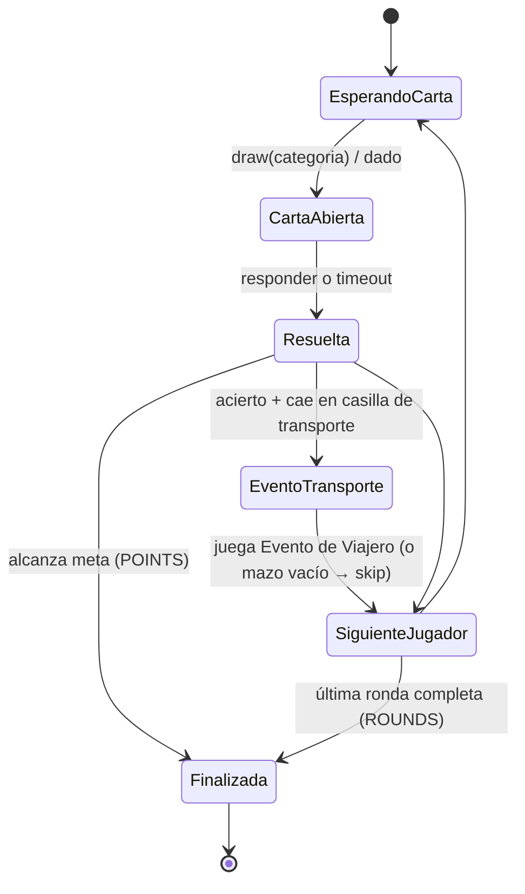
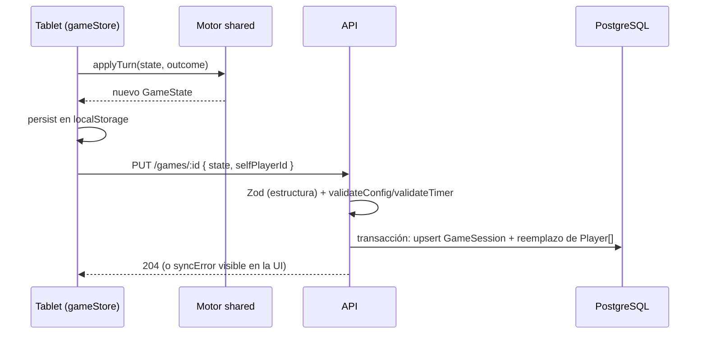

# Arquitectura de RoamPass Companion

> Documento de diseño de software (SDD) y referencia para desarrollo guiado por especificaciones.
> Describe **cómo está construida la app hoy** (rama `Feature.AddNewGameRules`, noviembre 2026),
> las decisiones que la sostienen y las reglas que cualquier cambio nuevo debe respetar.

---

## 1. Propósito y alcance

RoamPass es un juego de mesa **físico** (tablero impreso, dado, peones). La app es el
**"Director de Juego Digital"**: gestiona usuarios, hace de mazo de tarjetas interactivas, cronometra
las respuestas y calcula el puntaje (millas) en tiempo real. Opcionalmente el tablero también se
juega en pantalla (modo `DIGITAL`).

| Dentro del alcance | Fuera del alcance |
| --- | --- |
| Cuentas (ADMIN / PLAYER) con confirmación por correo y foto de pasaporte | Multijugador en red (varios dispositivos en la misma partida) |
| Configuración de partida, turnos, puntaje, victoria | Validación anti-trampa del puntaje en el servidor |
| Mazo de cartas (fotos, Street View, quiz, eventos) | Edición de cartas desde la UI (se cargan por seed) |
| Historial, estadísticas y "últimas partidas" | Pagos, notificaciones, tiempo real (websockets) |
| Reglas en la app y PDF imprimible | |

**Supuesto clave:** una partida se juega alrededor de **una sola tablet/dispositivo** que todos
comparten. La mesa es de confianza.

---

## 2. Vista general

Monorepo con **npm workspaces** y TypeScript de punta a punta:

```
roampass-companion/
├── shared/   @roampass/shared  Dominio puro: motor, reglas, puntaje, mazo, tablero (sin dependencias)
├── client/   @roampass/client  SPA React 19 + Vite + Tailwind v4 + Zustand + Leaflet
├── server/   @roampass/server  API REST Express 5 + Prisma 6 + PostgreSQL + JWT
├── deploy/                     Dockerfiles, Nginx y guía de despliegue
├── art/worldmap/               Generadores (Python) del tablero y PDFs para imprimir
└── .env                        Configuración única para los tres paquetes
```

```mermaid
flowchart LR
  subgraph Navegador
    UI[Componentes React] --> Stores[Zustand stores<br/>authStore · gameStore · themeStore]
    Stores --> Engine[@roampass/shared<br/>motor puro]
    Stores --> Api{api<br/>RoamPassApi}
    Api -->|VITE_API_URL definida| Http[httpApi]
    Api -->|sin VITE_API_URL| Local[localApi<br/>localStorage]
  end
  Http -->|REST + JWT| Server[Express 5]
  Server --> Engine2[@roampass/shared<br/>validaciones]
  Server --> Prisma[Prisma] --> PG[(PostgreSQL)]
  UI -.-> Ext[FlagCDN · OpenStreetMap · Google Maps Embed]
```

### Estilo arquitectónico

- **Núcleo de dominio compartido (shared kernel):** las reglas viven en un único paquete puro que
  importan cliente y servidor. Nunca se duplica lógica de juego.
- **Cliente "thick" / servidor "thin":** el cliente ejecuta el motor y es la fuente de verdad durante
  la partida; el servidor valida estructura, persiste snapshots y calcula estadísticas.
- **Puerto/adaptador en el cliente:** la interfaz `RoamPassApi` tiene dos implementaciones
  intercambiables (HTTP real o demo local).
- **Offline-first durante la partida:** el mazo se descarga una vez y el estado se persiste en
  `localStorage`; la sincronización con el servidor es *best effort*.

---

## 3. Paquete `shared` — el dominio

Funciones **puras e inmutables** (reciben estado, devuelven estado nuevo; `now` y `rng` se inyectan
para poder testear). No dependen de React, Express ni del DOM.

| Módulo | Responsabilidad |
| --- | --- |
| `types.ts` | Tipos del dominio: `Card` (unión `LocationCard \| QuizCard \| TravelEventCard`), `GameState`, `GamePlayer`, `VictoryCondition`, `BoardMode`, constantes (`POINT_TARGETS`, `ROUND_TARGETS`, `TIMER_OPTIONS`, `PAWN_COLORS`, `AVATARS`) |
| `engine.ts` | Ciclo de vida: `createGame`, `applyTurn`, `skipTransportEvent`, `finish`, `rankPlayers`, `progressToGoal`, validaciones; lanza `GameRuleError` |
| `scoring.ts` | Puntaje en millas: `QUIZ_POINTS`, `LOCATION_BRACKETS`, `DIFFICULTY_BONUS`, `scoreOutcome` |
| `geo.ts` | Haversine (`haversineKm`) y normalización de longitud |
| `board.ts` | Tablero (`data/board.json`): casillas monumento/transporte, `boardPosition`, dado (`DIE_FACES`, `rollDie`) |
| `deck.ts` | Robo sin repetición (`drawCard`), mezcla, RNG con semilla, `remainingByCategory`, URLs de FlagCDN, filtro foto/Street View |
| `countries.ts` | Genera cartas de banderas y capitales desde `data/countries.json` con 3 niveles de dificultad |
| `rules.ts` / `labels.ts` | Textos de reglas y etiquetas derivados de las constantes (la guía de la app y el PDF no se desincronizan) |

**Datos estáticos** (`shared/data/`): `seedData.json` (cartas escritas a mano), `countries.json`
(194 países), `board.json` (casillas del tablero).

### 3.1 Modelo de estado

```ts
GameState {
  id                  // generado en el cliente → sincronización idempotente
  config              // { mode: 'POINTS'|'ROUNDS', target, board?: 'PHYSICAL'|'DIGITAL' }
  players[]           // { id, name, color, avatar, score, stats }
  currentPlayerIndex, round, status: 'PLAYING'|'FINISHED'
  history[]           // un registro por carta jugada (delta efectivo, acierto, distancia, timeout)
  usedCardIds[]       // garantiza que ninguna carta se repite
  timerSeconds?       // 10..30
  transportEvent?     // true: el jugador debe jugar un Evento de Viajero en el mismo turno
  finishedAt?, winnerIds?
}
```

### 3.2 Flujo de un turno



### 3.3 Invariantes del dominio (contrato que todo cambio debe preservar)

1. 1 casilla = **500 millas**; vuelta al mundo = 50 casillas = **25.000**. Todo premio es múltiplo de 500.
2. El puntaje **nunca baja de 0**; `history` guarda el delta **efectivamente aplicado**.
3. Una carta usada no vuelve a salir en la misma partida (`usedCardIds`).
4. Con `transportEvent` activo solo se acepta un outcome `EVENT`; lo que mueva ese evento no encadena otro.
5. `POINTS` termina apenas alguien llega a la meta; `ROUNDS` cuando el último jugador cierra la ronda objetivo.
6. Ranking: millas ↓, luego aciertos ↓; empate total comparte posición (1, 1, 3…).
7. Bonus de dificultad **aditivo** (+0 / +500 / +1.000) y solo si la respuesta ya da millas; los eventos no llevan bonus.
8. 2 a 4 jugadores; timer ∈ {10, 15, 20, 25, 30} s.

---

## 4. Cliente (`client/`)

**Stack:** React 19, Vite 7, Tailwind v4, Framer Motion, Zustand 5 (con `persist`),
react-router 7, react-leaflet 5.

### 4.1 Capas

```
components/  (presentación)  →  store/ (estado + casos de uso)  →  api/ (puerto)  +  @roampass/shared (dominio)
```

| Capa | Archivos | Notas |
| --- | --- | --- |
| Rutas | `App.tsx` | `/login`, `/`, `/setup`, `/play`, `/profile`, `/rules`; `RequireAuth` revalida el token con `me()` |
| Stores | `authStore.ts` | Token + usuario, persistido como `roampass-auth` |
| | `gameStore.ts` | Envuelve el motor: `startGame`, `draw`, resolver, `resumeGame`, `ensureDeck`; persiste la partida **y la carta abierta** (con `deadline` absoluto para que refrescar no reinicie el reloj); llama a `sync()` tras cada cambio |
| | `themeStore.ts` | Estilo visual (`COMIC` / `RETRO`) |
| API | `api/types.ts` | Interfaz `RoamPassApi` (contrato único) |
| | `api/httpApi.ts` | `fetch` + `Authorization: Bearer` |
| | `api/localApi.ts` | Modo demo: misma interfaz sobre `localStorage`, hash SHA-256 con sal; **no seguro** |
| UI | `components/{auth,dashboard,setup,game,rules,tour,profile,layout,ui}` | Ver tabla de componentes en el README |

### 4.2 Carga del mazo

`loadDeck()` = cartas del backend (o `seedData.json` si el backend falla) → `filterLocationMode`
(Street View si hay `VITE_GOOGLE_MAPS_API_KEY`, si no fotos; nunca se mezclan) → + cartas de
banderas/capitales generadas localmente desde `countries.json`.

### 4.3 Integraciones externas (solo desde el navegador)

- **FlagCDN** — imágenes de banderas.
- **Leaflet + OpenStreetMap** — mapa para marcar la respuesta en cartas LUGAR.
- **Google Maps Embed API** — Street View 360° (opcional, con API key `VITE_`).
- **Wikimedia Commons** — fotos de lugares, con crédito/licencia en `credit`.

---

## 5. Servidor (`server/`)

**Stack:** Express 5 (errores async propagados), Prisma 6, PostgreSQL, Zod 4, bcryptjs,
jsonwebtoken, express-rate-limit. Se ejecuta con `tsx` (sin paso de build).

### 5.1 Estructura

| Archivo | Rol |
| --- | --- |
| `index.ts` / `app.ts` | Arranque y composición: CORS, JSON (1 MB), `trust proxy`, routers, `errorHandler` |
| `env.ts` / `loadEnv.ts` | Lee el `.env` de la raíz; `JWT_SECRET` obligatorio |
| `http.ts` | `HttpError` y traducción de errores → JSON (`GameRuleError`/Zod → 400, P2002 → 409, P2025 → 404) |
| `auth/middleware.ts` | `requireAuth` (verifica JWT **y recarga el usuario**: desactivar corta el acceso al instante), `requireAdmin` |
| `auth/rateLimit.ts` | Login: 10 fallos / 15 min por IP. Registro: 5 / hora. Correos: 3 / hora. IP real detrás de Cloudflare (`TRUST_CLOUDFLARE`) |
| `auth/emailTokens.ts` | Enlaces de un solo uso (hash SHA-256) y limpieza de registros sin confirmar |
| `auth/captcha.ts` | Turnstile de Cloudflare en el registro (apagado sin clave) |
| `mail/` | Envío SMTP con nodemailer y textos de los correos |
| `photos.ts` | Normaliza la foto del pasaporte con sharp (WebP 256×256, sin metadatos) |
| `routes/*.ts` | Endpoints (ver 5.2) |
| `cardMapper.ts` | `Card` (unión discriminada) ↔ fila plana `CardQuestion` |
| `db.ts` | Singleton de `PrismaClient` |

### 5.2 API REST (`/api`)

| Método | Ruta | Auth | Descripción |
| --- | --- | --- | --- |
| GET | `/health` | — | `{ ok: true }` |
| POST | `/auth/register` | rate limit + captcha | Crea el usuario **sin confirmar** y envía el correo; responde `{ pending: true }` (sin token) |
| POST | `/auth/login` | rate limit | `{ identifier, password }` (usuario o correo) → `{ token, user }`; 403 `EMAIL_NOT_VERIFIED` / `ACCOUNT_INACTIVE` |
| POST | `/auth/verify-email` | rate limit | Confirma el registro o el cambio de correo |
| POST | `/auth/resend-verification`, `/auth/forgot-password` | rate limit | Envían el correo; respuesta genérica |
| POST | `/auth/reset-password` | rate limit | Contraseña nueva con el enlace |
| GET / PATCH | `/auth/me` | usuario | Perfil; cambia tema, contraseña y correo (exigen la actual) |
| PUT / DELETE | `/auth/me/photo` | usuario | Sube (imagen `image/*`) o quita la foto del pasaporte |
| GET / DELETE | `/users/:id/photo` | usuario / ADMIN | Ver la foto (con sesión) / quitarla (moderación) |
| GET / POST | `/users` | ADMIN | Listar (con `gamesHosted`) / crear |
| PATCH / DELETE | `/users/:id` | ADMIN | Activar, rol, renombrar, contraseña / eliminar |
| GET | `/cards` | usuario | Mazo activo completo |
| PUT | `/games/:id` | usuario | **Upsert idempotente** del snapshot `{ state, selfPlayerId }`; solo el host |
| GET | `/games/active` | usuario | Última partida en curso del usuario (para reanudar) |
| GET | `/games/stats/me` | usuario | Jugadas, ganadas, récord |
| GET | `/games/recent?limit=` | usuario | Últimas partidas (ADMIN ve todas) |
| DELETE | `/games/:id` | host o ADMIN | Elimina la partida (cascada a jugadores) |

Formato de error uniforme: `{ error: string, code?: string, issues? }`. El `code` es estable y sirve para traducir el mensaje.

### 5.3 Sincronización de partidas



El servidor **no recalcula** el puntaje: valida forma y configuración, guarda el snapshot completo
en `GameSession.state` (JSON) y proyecta columnas planas (`status`, `score`, `isWinner`…) para
consultas y estadísticas.

---

## 6. Modelo de datos (PostgreSQL vía Prisma)

```mermaid
erDiagram
  User ||--o{ GameSession : "hostea"
  User |o--o{ Player : "juega como (opcional)"
  GameSession ||--|{ Player : "tiene 2..4"
  User { string id PK; string username UK; string email UK; datetime emailVerifiedAt; string passwordHash; Role role; bool isActive; UiTheme theme }
  User ||--o| UserPhoto : "foto"
  User ||--o{ EmailToken : "enlaces"
  UserPhoto { string userId PK; bytes data "WebP 256x256" }
  EmailToken { string id PK; string tokenHash UK; EmailTokenPurpose purpose; datetime expiresAt; datetime usedAt }
  GameSession { string id PK "generado en cliente"; string hostId FK; VictoryMode victoryMode; int target; GameStatus status; int currentRound; json state "snapshot del motor"; datetime finishedAt }
  Player { string id PK; string sessionId FK; string userId FK "null = invitado"; int turnOrder; string name; int score; bool isWinner; json stats }
  CardQuestion { string id PK "slug estable"; CardCategory category; Difficulty difficulty; string prompt; string[] options; float latitude; float longitude; int points; bool isActive }
```

- **Patrón híbrido documento + relacional:** `state` es la fuente para reanudar; las columnas son
  una proyección para consultar.
- `Player` se reescribe completo en cada sync (delete + createMany dentro de la transacción).
- `CardQuestion` es una tabla "ancha": cada categoría usa un subconjunto de columnas.
- Migraciones en `server/prisma/migrations/`; el seed (`prisma/seed.ts`) hace upsert de las cartas
  de `seedData.json` y del admin inicial (`ADMIN_USERNAME` / `ADMIN_PASSWORD`).

---

## 7. Seguridad

| Aspecto | Implementación |
| --- | --- |
| Contraseñas | bcrypt (10 rondas) en servidor |
| Sesión | JWT HS256, 7 días, en `localStorage` (Zustand persist) |
| Autorización | Roles `ADMIN` / `PLAYER`; ownership por `hostId` en partidas |
| Alta de cuentas | El registro público se activa con un enlace enviado por correo (24 h, un solo uso, se guarda solo el hash). Las cuentas sin confirmar se borran a los 7 días. Captcha Turnstile opcional |
| Fotos | Re-procesadas en el servidor (sin EXIF/GPS) y servidas solo con sesión |
| Fuerza bruta | Rate limit por IP; `trust proxy` limitado a loopback/redes privadas |
| Validación | Zod en todos los bodies |
| Secretos | Un solo `.env`; solo variables `VITE_*` llegan al bundle |
| Superficie | Contenedores publicados solo en `127.0.0.1`; entrada por Nginx de la VM |

**Riesgos aceptados:** el puntaje lo calcula el cliente (un usuario autenticado podría enviar un
snapshot manipulado de su propia partida); el JWT en `localStorage` es vulnerable ante XSS; no hay
revocación de tokens más allá de desactivar la cuenta.

---

## 8. Despliegue

```
Navegador ──► Nginx de la VM :8080 ─┬─ /api/* ──► roampass-api (127.0.0.1:4100 → :4000, Express + Prisma)
                                    └─ /*     ──► roampass-web (127.0.0.1:3100 → :80, SPA en Nginx)
roampass-api ──(red docker dev-net)──► postgres:5432 (PostgreSQL compartido)
```

- `docker-compose.yml`: PostgreSQL local para desarrollo.
- `docker-compose.prod.yml`: `api` + `web`. La imagen de la API corre `prisma migrate deploy` al
  arrancar. La SPA se compila con `VITE_API_URL=/api` (mismo origen, sin CORS en producción).
- Guía paso a paso: [`deploy/DEPLOY.md`](../deploy/DEPLOY.md).

### Modos de ejecución

| Modo | Cómo | Persistencia |
| --- | --- | --- |
| Demo | `npm run dev` sin `VITE_API_URL` | `localStorage` (`localApi`) |
| Desarrollo completo | `docker compose up -d` + `dev:server` + `dev` | PostgreSQL |
| Producción | `docker compose up -d --build` en la VM | PostgreSQL compartido |

---

## 9. Calidad y pruebas

- **Vitest** en `shared/test/` (motor, tablero, reglas: 53 tests). Es donde vive la lógica crítica.
- `npm run typecheck` en los tres paquetes (TS estricto, `tsconfig.base.json`).
- No hay tests de cliente ni de API todavía.

---

## 10. Decisiones de arquitectura (ADR resumidos)

| # | Decisión | Motivo | Consecuencia |
| --- | --- | --- | --- |
| 1 | Motor de juego en paquete puro compartido | Una sola fuente de reglas | Cambiar una regla = tocar `shared` + tests; cliente y servidor la heredan |
| 2 | El cliente es autoritativo en la partida | Mesa física y de confianza; funciona sin red | El servidor no previene trampas |
| 3 | Snapshot JSON + columnas proyectadas | Reanudar exacto sin modelar cada evento | Hay que mantener la proyección al agregar campos consultables |
| 4 | ID de partida generado en el cliente + `PUT` upsert | Reintentos idempotentes, offline-first | Ownership verificado contra `hostId` |
| 5 | `RoamPassApi` con adaptador local | Probar sin backend | Cada endpoint nuevo debe implementarse en **ambos** adaptadores |
| 6 | Cartas de países generadas, no guardadas | 194 países sin inflar la BD | Viven en `countries.json` |
| 7 | Registro con confirmación por correo (antes: aprobación de ADMIN) | App expuesta en Internet sin depender del admin | Necesita SMTP (Brevo) y un dominio con SPF/DKIM |
| 8 | Un solo `.env` en la raíz | Configuración simple | Disciplina con el prefijo `VITE_` |
| 9 | `tsx` en producción, sin build del servidor | Simplicidad | Imagen más pesada (incluye devDependencies) |

---

## 11. Guía para desarrollo guiado por especificaciones (SDD)

Cómo escribir y aplicar una spec nueva en este repo:

1. **Ubicar la capa.** ¿Cambia una regla? → `shared`. ¿Persistencia/permisos? → `server` + Prisma.
   ¿Presentación/flujo? → `client`. La mayoría de features de juego tocan las tres en ese orden.
2. **Spec mínima** (sugerido `docs/specs/<feature>.md`): objetivo, reglas en lenguaje de dominio,
   cambios a `GameState`/tipos, invariantes afectados (sección 3.3), endpoints, criterios de
   aceptación en formato *Dado / Cuando / Entonces*.
3. **Orden de implementación:**
   1. Tipos y constantes en `shared/src/types.ts`.
   2. Lógica pura + tests en `shared/test/` (los criterios de aceptación se vuelven tests).
   3. Textos en `rules.ts` / `labels.ts` (alimentan la guía y el PDF: `npm run rules:pdf`).
   4. Si se persiste: `schema.prisma` + migración, `stateSchema` (Zod) en `routes/games.ts`, y
      proyección en el upsert.
   5. `RoamPassApi` + `httpApi` + `localApi`.
   6. Store (`gameStore`) y componentes.
4. **Compatibilidad hacia atrás:** los campos nuevos de `GameState` deben ser **opcionales** con
   default (patrón ya usado en `board?`, `timerSeconds?`, `transportEvent?`) porque hay partidas
   guardadas en `localStorage` y en la BD.
5. **Definición de terminado:** `npm test` y `npm run typecheck` en verde, README/reglas actualizados.

---

## 12. Deuda técnica y observaciones

- Sin tests de integración de la API ni de componentes.
- Sin validación semántica de puntaje en el servidor (ver ADR 2).
- `stats` de jugador como JSON: las estadísticas por categoría no son consultables por SQL.
