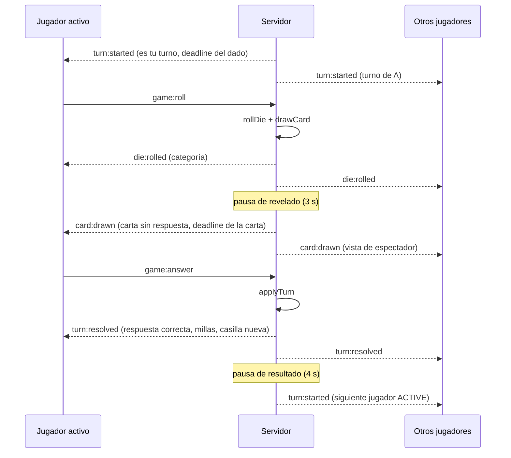

# Spec: Modo online multijugador

| | |
| --- | --- |
| Estado | **Implementado** — E0 a E7 en la rama `Feature.Multiplayer` (ver 14) |
| Fecha | 2026-11-18 |
| Afecta | `shared`, `server`, `client`, `deploy` |
| Relacionado | [ARCHITECTURE.md](../ARCHITECTURE.md) (secciones 3.3, 5.3, 10 y 11) · [admin-panel.md](admin-panel.md) |

---

## 1. Objetivo

Que de 2 a 6 usuarios registrados jueguen **la misma partida desde dispositivos distintos**. El
anfitrión crea una sala, invita jugadores buscándolos por nombre y arranca la partida. Todos ven en
tiempo real el dado, la carta, la respuesta y el avance en el mapa. Solo el jugador en turno puede actuar.

## 2. Alcance

### Incluido

- Sala de espera: crear, invitar, aceptar o rechazar y empezar.
- Partidas de **2 a 6 jugadores**, todos registrados, con **tablero digital**.
- Dado, cartas, timers y puntaje calculados por el servidor; todos ven todo en vivo.
- Pausa del jugador y de la partida, pase de turno manual y por inactividad, abandono y regreso.
- Sumarse a una partida ya empezada, con millas iniciales.
- Rol de **anfitrión** que se transfiere si abandona.
- Reconexión: refrescar o perder la red no rompe la partida.
- Ocultar una partida del propio panel.
- **El máximo pasa a 6 jugadores también en el modo local** (y se regenera el PDF de reglas).

### Fuera de alcance

- **Chat** (posible etapa futura, sin decidir).
- Invitados sin cuenta, emparejamiento aleatorio, espectadores.
- Ocultar por completo las respuestas en las URLs de las imágenes (ver 9.2).
- Tablero físico en modo online.
- Modo online en el modo demo (`localApi`).
- Panel de administración del sistema y admin único: van en [admin-panel.md](admin-panel.md).

## 3. Decisiones

| # | Decisión | Motivo |
| --- | --- | --- |
| D1 | **El servidor es autoritativo** en las partidas online: tira el dado, roba la carta, controla los timers y calcula las millas | Sin esto cualquiera puede mandar cualquier puntaje (ARCHITECTURE, ADR 2) |
| D2 | El backend sigue siendo **Node + Express 5**; tiempo real con **Socket.IO** | El servidor reutiliza `@roampass/shared`: una sola fuente de verdad para las reglas |
| D3 | La lógica online son **funciones puras en `shared/src/online.ts`**; el servidor solo orquesta (sockets, BD, timers) | Se testea con Vitest igual que el motor actual |
| D4 | En modo online el cliente **no ejecuta el motor**: muestra la vista que manda el servidor y envía acciones | Un solo cálculo, sin estados divergentes |
| D5 | Se reutiliza `GameSession` con `kind = ONLINE` | Estadísticas y "Últimas partidas" siguen funcionando |
| D6 | Una sola instancia del servidor: timers y locks en memoria, sin Redis | Escala actual (una VM) |
| D7 | Online siempre usa **tablero digital** y **siempre se tira el dado** (no se elige la carta) | No hay tablero físico compartido; el dado del servidor evita elegir la categoría que conviene |
| D8 | Los **Eventos de Viajero se aplican solos** (incluido el de casilla de transporte) | No tienen pregunta |
| D9 | `MAX_PLAYERS` pasa de 4 a **6** para los dos modos | Partidas más cortas que con 8; ya existen 6 colores de peón |

## 4. Glosario

| Término | Significado |
| --- | --- |
| **Admin del sistema** | El único usuario con rol `ADMIN` (ver admin-panel.md). No tiene poderes especiales dentro de las partidas online ajenas |
| **Creador** | Quien creó la sala. No cambia nunca (`GameSession.hostId`) |
| **Anfitrión** | Quien administra la partida en este momento. Empieza siendo el creador y se transfiere si abandona |
| **Jugador activo** | El que tiene el turno |
| **Estado del jugador** | `ACTIVE` (juega), `PAUSED` (sus turnos se saltan) o `ABANDONED` (salió) |
| **Carta pendiente** | Carta robada y sin responder. Su respuesta vive solo en el servidor |
| **Vista pública** | El estado de la partida sin datos secretos; lo único que reciben los clientes |

## 5. Flujos de usuario

### 5.1 Crear la sala e invitar

1. En el panel, el usuario elige **"Jugar online"**.
2. Configura la condición de victoria (millas o rondas), el **tiempo por carta** (10–30 s), el
   **tiempo para tirar el dado** (30 / 60 / 90 / 120 s, 60 por defecto), y su color y avatar.
3. Busca jugadores por nombre (mínimo 2 letras) y los invita (hasta completar 6 contando al anfitrión).
4. Queda en la **sala de espera**: ve quién aceptó, quién rechazó y quién no respondió. Puede invitar
   a más o cancelar la sala.
5. Con al menos 2 jugadores (él + 1 que aceptó) se habilita **"Empezar"**.
6. Al empezar, las invitaciones sin responder se cancelan.

### 5.2 Recibir una invitación

1. Si el invitado está conectado, le aparece un aviso: *"`<anfitrión>` te invita a una partida"*, con la configuración.
2. Si no lo está, la ve en la sección **"Invitaciones"** del panel al entrar.
3. Al aceptar elige un color libre y su avatar. Si la partida no empezó, entra a la sala de espera;
   si ya empezó, entra directo a la mesa (5.6).
4. La invitación vence a los **10 minutos**.

### 5.3 Jugar un turno



- Los demás ven el dado, la carta, la cuenta regresiva y el resultado, sin poder actuar.
- **Antes de tirar**, el jugador activo puede pulsar **"Pasar turno"**.
- Si sale un **Evento de Viajero**, tras la pausa de revelado se aplica solo y se emite `turn:resolved`.
- Si el activo acierta y cae en una **casilla de transporte**, el servidor roba y aplica un evento en el mismo turno (o lo salta si no quedan).

### 5.4 Cartas LUGAR

| | Jugador activo | Los demás |
| --- | --- | --- |
| Carta con foto | La foto + el mapa para marcar | La misma foto, sin mapa |
| Carta Street View | El panorama 360° interactivo + el mapa (igual que hoy) | Una **foto fija** del mismo punto (Street View Static API), sin mapa |
| Al resolverse | Mapa con el punto real y el elegido | Lo mismo |

### 5.5 Pausa, pase y abandono

| Acción | Quién | Efecto |
| --- | --- | --- |
| **Pausarme** | Cualquier jugador (también el anfitrión) | Pasa a `PAUSED`; sus turnos se saltan. Si era su turno, el turno pasa |
| **Reactivarme** | Solo el mismo jugador | Vuelve a `ACTIVE` y juega cuando le toque |
| **Pausa automática** | El servidor | Tras **3 turnos perdidos seguidos** (ver RN-11) |
| **Pausar / reanudar la partida** | Solo el anfitrión | Congela todos los timers, incluido el de una carta abierta, que al reanudar sigue con el tiempo que le quedaba |
| **Terminar la partida** | Solo el anfitrión | Termina; gana el que tiene más millas (RN-16) |
| **Abandonar** | Cualquier jugador | Pasa a `ABANDONED`. Conserva sus millas y sigue en el ranking como "Abandonó" |
| **Volver a la partida** | Quien abandonó, desde su panel | Vuelve a `ACTIVE` **con las millas que tenía**, sin necesitar invitación |
| **Ocultar de mi panel** | Cualquier participante | La partida deja de aparecerle. Si estaba en curso, equivale a abandonar |

### 5.6 Sumarse con la partida empezada

1. El anfitrión invita a alguien y le asigna **millas iniciales** (múltiplo de 500, entre 0 y las
   millas del que va primero; en modo millas, por debajo de la meta).
2. Al aceptar, el jugador entra **al final del orden de turnos**, en la casilla correspondiente a sus millas iniciales.
3. Las millas iniciales suman al marcador pero **no** a aciertos ni a puntos por categoría.

### 5.7 Fin de la partida

| Cómo termina | Ganador |
| --- | --- |
| Alguien llega a la meta (modo millas) | Quien llegó |
| Se completa la última ronda (modo rondas) | El que tiene más millas, **incluyendo a los que abandonaron** |
| El anfitrión pulsa "Terminar" | El que tiene más millas, incluyendo a los que abandonaron |
| Queda un solo jugador sin abandonar | **Ese jugador**, tenga las millas que tenga |

- Al terminar, los que estaban en `PAUSED` pasan a `ABANDONED`.
- Desempate: el actual (más aciertos; si persiste, comparten posición).
- Todos ven la pantalla de victoria; el ranking muestra la marca "Abandonó".

## 6. Reglas de negocio online

Siguen vigentes las reglas del motor (ARCHITECTURE 3.3). Se agregan:

**Sala e invitaciones**

| Id | Regla |
| --- | --- |
| RN-01 | Solo se puede buscar e invitar a usuarios **activos** del sistema. Nadie se invita a sí mismo. |
| RN-02 | Un usuario puede estar en **una sola partida online** a la vez (en sala, `PLAYING` en cualquier estado, incluido `PAUSED`). Para entrar a otra, primero tiene que abandonar. Una partida en la que está `ABANDONED` no cuenta. |
| RN-03 | Máximo **6 jugadores no abandonados**. Los que abandonaron no ocupan lugar, pero conservan su color. Si ya hay 6 jugadores no abandonados, quien abandonó no puede volver hasta que se libere un lugar. |
| RN-04 | Las invitaciones vencen a los 10 minutos. Aceptar una vencida, cancelada o de una partida terminada devuelve error. |
| RN-05 | Solo el **anfitrión** invita, también con la partida empezada (5.6). |

**Turnos**

| Id | Regla |
| --- | --- |
| RN-06 | El servidor **rechaza** cualquier acción de quien no es el jugador activo, aunque el botón esté oculto en la UI. |
| RN-07 | El dado lo tira **el servidor**. Si sale una categoría agotada, vuelve a tirar (`rollDie` actual). |
| RN-08 | **Tiempo para tirar:** el configurado en la partida. Si vence, el turno pasa con **0 millas** y el aviso "tiempo agotado". |
| RN-09 | **Tiempo por carta:** el configurado + **2 s de gracia** por latencia. Si vence, la carta cuenta como error (0 millas), igual que hoy. Una respuesta tardía se rechaza. |
| RN-10 | **"Pasar turno"** solo antes de tirar el dado: 0 millas, sin aviso de tiempo. |
| RN-11 | **Turno perdido** = dado no tirado (RN-08) o carta sin responder (RN-09). Al **tercero seguido**, el jugador pasa a `PAUSED`. Jugar un turno pone el contador en 0. El pase manual (RN-10) no cuenta ni reinicia. |
| RN-12 | Un turno salteado (RN-08, RN-10) queda en el historial pero **no** cuenta como carta jugada ni como error. Una carta vencida (RN-09) sí cuenta como error, igual que hoy. |
| RN-13 | Los turnos de jugadores `PAUSED` o `ABANDONED` se saltan al instante. Las rondas siguen avanzando igual. Si **no queda ningún jugador `ACTIVE`**, la partida espera sin timers hasta que alguien se reactive. |
| RN-14 | Las opciones de la carta se mezclan **en el servidor** y se guardan con la carta pendiente: todos ven el mismo orden, también al reconectar. |
| RN-15 | Pausas fijas (no configurables): **3 s** de revelado entre el dado y la carta, y **4 s** mostrando el resultado antes del turno siguiente. |

**Fin y anfitrión**

| Id | Regla |
| --- | --- |
| RN-16 | El ganador se define según la tabla de 5.7. **Quien abandonó puede ganar**, salvo cuando la partida termina por "último en pie". |
| RN-17 | Si el anfitrión abandona, el rol pasa al siguiente jugador **`ACTIVE`** en orden de invitación; si no hay ninguno activo, al primer `PAUSED`. Si la partida estaba pausada por el anfitrión, el nuevo anfitrión puede reanudarla. |
| RN-18 | Si queda **un solo jugador no abandonado**, la partida termina y gana él (los `PAUSED` cuentan como no abandonados). |
| RN-19 | Una partida online **no se puede sobrescribir** con `PUT /games/:id` (409). |
| RN-20 | Solo los participantes pueden ver la partida en vivo. El admin del sistema la ve en "Últimas partidas" como ya pasa con las locales. |
| RN-21 | "Ocultar de mi panel" solo afecta a quien lo pide; la partida sigue contando en sus estadísticas. Las partidas **locales** se siguen eliminando como hoy. |

## 7. Modelo de datos

### 7.1 Prisma

```prisma
enum GameKind {
  LOCAL
  ONLINE
}

enum GameStatus {
  LOBBY      // nuevo: sala de espera
  PLAYING
  FINISHED
}

enum InviteStatus {
  PENDING
  ACCEPTED
  DECLINED
  CANCELLED
  EXPIRED
}

model GameSession {
  // ... campos actuales (hostId = creador, no cambia) ...
  kind    GameKind @default(LOCAL)
  /// Se incrementa en cada acción aplicada (concurrencia optimista).
  version Int      @default(0)
  invites GameInvite[]
}

model Player {
  // ... campos actuales ...
  /// Partida oculta del panel de este jugador (solo online).
  hiddenAt DateTime?
}

model GameInvite {
  id           String       @id @default(cuid())
  sessionId    String       // la sala ya existe al invitar
  fromUserId   String
  toUserId     String
  /// Millas iniciales si se suma con la partida empezada.
  initialMiles Int          @default(0)
  status       InviteStatus @default(PENDING)
  createdAt    DateTime     @default(now())
  expiresAt    DateTime
  respondedAt  DateTime?

  @@index([toUserId, status])
  @@index([sessionId, status])
}
```

En partidas online, `Player.userId` es obligatorio y las filas `Player` las mantiene el servidor.

### 7.2 Estado (en `shared`)

Se agrega un campo **opcional** a `GamePlayer`, así el modo local no cambia:

```ts
type PlayerPresence = 'ACTIVE' | 'PAUSED' | 'ABANDONED';

interface GamePlayer {
  // ... campos actuales ...
  /** Solo online. undefined = ACTIVE. */
  presence?: PlayerPresence;
}
```

`advance()` del motor salta a los jugadores `PAUSED` y `ABANDONED` (RN-13). En local nunca se usa,
así que se comporta igual que hoy.

```ts
interface OnlineMeta {
  /** userId de cada peón, en el mismo orden que players. */
  userIds: string[];
  /** playerId del anfitrión actual. */
  hostPlayerId: string;
  /** Orden en que se invitó a cada jugador (para transferir el anfitrión, RN-17). */
  invitationOrder: string[];
  dieTimeoutSeconds: 30 | 60 | 90 | 120;
  phase: 'AWAITING_ROLL' | 'REVEALING' | 'AWAITING_ANSWER' | 'SHOWING_RESULT' | 'IDLE';
  /** Hora límite (ISO) de la fase actual. */
  deadline?: string;
  /** Pausa de la partida entera: tiempo que le quedaba a la fase al pausar. */
  pausedByHost?: { remainingMs: number; at: string };
  /** Carta robada y sin responder. SECRETA: nunca sale del servidor tal cual. */
  pending?: { cardId: string; dieFace: number; options?: string[] };
  /** Turnos perdidos seguidos por playerId (RN-11). */
  missedTurns: Record<string, number>;
  /** Millas iniciales por playerId (5.6), para separarlas de las estadísticas. */
  initialMiles: Record<string, number>;
  /** Cómo terminó: GOAL | ROUNDS | HOST_ENDED | LAST_STANDING. */
  endReason?: string;
}

type OnlineGameState = GameState & { online: OnlineMeta };
```

### 7.3 Vista pública

```ts
interface PublicGameView {
  state: OnlineGameState sin online.pending;
  pendingCard?: PublicCard;      // carta pendiente según el rol del que mira (tabla abajo)
  lastResolution?: Resolution;   // último turno resuelto, con respuesta correcta y punto elegido
  you: { playerId: string; isActive: boolean; isHost: boolean };
}
```

| Categoría | Jugador activo recibe | Los demás reciben | Se revela en `turn:resolved` |
| --- | --- | --- | --- |
| LOCATION con foto | foto | foto | `location`, `answerLabel`, punto elegido |
| LOCATION Street View | coordenadas del panorama | URL de foto fija (servida por la API, sin coordenadas) | `location`, `answerLabel`, punto elegido |
| FLAG / CITY / HISTORY / PERSONALITY | enunciado, imagen, opciones | lo mismo | `correctAnswer`, `funFact`, opción elegida |
| TRAVEL_EVENT | todo | todo | — |

## 8. Interfaces

### 8.1 Funciones puras (`shared/src/online.ts`)

| Función | Qué hace |
| --- | --- |
| `createOnlineGame(config, host, now)` | Sala con el anfitrión |
| `addPlayer(state, setup, userId, initialMiles)` | Suma un jugador (sala o partida en curso, 5.6). Valida RN-03 |
| `startOnlineGame(state, now)` | Pasa de sala a `PLAYING` |
| `roll(state, deck, rng, now)` | Tira el dado, roba la carta, mezcla opciones, fase `REVEALING` |
| `revealCard(state, now)` | Fin de la pausa de revelado: `AWAITING_ANSWER` (o aplica el evento, D8) |
| `submitAnswer(state, deck, userId, answer, now)` | Valida turno y deadline, llama a `applyTurn`, resuelve el transporte |
| `passTurn(state, userId, now)` | RN-10 |
| `expireDeadline(state, deck, rng, now)` | RN-08 / RN-09 / RN-11 según la fase |
| `setPresence(state, userId, presence, now)` | Pausarse, reactivarse, abandonar, volver. Aplica RN-17 y RN-18 |
| `hostPause(state, userId, now)` / `hostResume(...)` / `hostEnd(...)` | Acciones del anfitrión |
| `nextTurn(state, now)` | Fin de la pausa de resultado; salta jugadores no activos |
| `toPublicView(state, deck, viewerUserId)` | Vista pública (7.3) |

Todas devuelven un estado nuevo y lanzan `GameRuleError` ante una acción inválida.

### 8.2 REST (nuevos, todos con `requireAuth`)

| Método | Ruta | Descripción |
| --- | --- | --- |
| GET | `/api/users/search?q=` | Hasta 10 usuarios activos que empiecen con `q` (mínimo 2 letras), sin incluirte. Solo `{ id, username }`. Rate limit de 30/min |
| POST | `/api/online` | Crea la sala `{ config, dieTimeoutSeconds, color, avatar }` |
| GET | `/api/online/current` | Tu partida online actual (sala o en curso), si tienes |
| POST | `/api/online/:id/invites` | Anfitrión invita `{ toUserId, initialMiles? }` |
| GET | `/api/invites` | Tus invitaciones pendientes |
| POST | `/api/invites/:id/accept` | `{ color, avatar }` |
| POST | `/api/invites/:id/decline` | Rechaza |
| DELETE | `/api/invites/:id` | El anfitrión cancela |
| POST | `/api/online/:id/rejoin` | Volver tras abandonar |
| POST | `/api/online/:id/hide` | Ocultar de mi panel |
| GET | `/api/online/:id/streetview-photo` | Foto fija para los que no tienen el turno (proxy de Street View Static API) |

Las acciones de juego van por Socket.IO.

### 8.3 Socket.IO

- Ruta `/socket.io/`, mismo origen que la API. Autenticación con el mismo JWT en el handshake (`auth: { token }`).
- Salas: `user:{userId}` (invitaciones) y `game:{sessionId}` (solo participantes no abandonados).
- Las acciones usan **acknowledgement**: `{ ok: true }` o `{ error }`.
- Tipos de los eventos definidos una sola vez en `shared/src/protocol.ts`.
- La vista pública depende de quién mira: el servidor emite a cada socket por separado.

**Cliente → servidor**

| Evento | Quién |
| --- | --- |
| `game:join { sessionId }` | Participante. Responde con la vista completa |
| `game:start` | Anfitrión, en sala con ≥ 2 jugadores |
| `game:roll` / `game:pass` | Jugador activo en `AWAITING_ROLL` |
| `game:answer { answer \| guess }` | Jugador activo en `AWAITING_ANSWER` |
| `player:pause` / `player:resume` / `player:abandon` | El propio jugador |
| `host:pause` / `host:resume` / `host:end` | Anfitrión |

**Servidor → cliente**

| Evento | Sala | Contenido |
| --- | --- | --- |
| `invite:received` / `invite:updated` | `user:` | Invitación nueva o cambio de estado |
| `game:state` | `game:` | Vista pública completa |
| `turn:started` | `game:` | Jugador activo y deadline del dado |
| `die:rolled` | `game:` | Cara y categoría |
| `card:drawn` | `game:` | Carta según quién mira |
| `turn:resolved` | `game:` | Resultado, respuesta correcta y lo elegido |
| `turn:skipped` | `game:` | Por tiempo o pase manual |
| `player:presence` | `game:` | Cambio de estado de un jugador o del anfitrión |
| `connection:presence` | `game:` | Conectado / desconectado (solo informativo) |
| `game:finished` | `game:` | Ranking, ganador y motivo |

## 9. Aspectos técnicos

### 9.1 Timers y concurrencia

- Los deadlines se guardan en el estado (BD). El servidor programa un `setTimeout` por partida.
- **Al arrancar**, reprograma los timers de las partidas `PLAYING`; si alguno venció con el servidor caído, lo resuelve.
- Cada acción (incluidos los timers) pasa por una **cola por partida**: se procesa una a la vez.
- Escritura con `version` (`UPDATE … WHERE id = ? AND version = ?`); si no coincide, se descarta y se reenvía el estado.

### 9.2 Modelo de amenazas

| Amenaza | ¿Se cubre? |
| --- | --- |
| Manipular el puntaje o jugar fuera de turno | **Sí** |
| Elegir la categoría o volver a tirar el dado | **Sí** |
| Responder fuera de tiempo | **Sí** |
| Ver la respuesta en los datos de la API | **Sí** |
| Que los espectadores vean las coordenadas de Street View | **Sí** (foto por proxy). Igual, los espectadores no responden |
| El jugador activo deduce la respuesta por la URL de la imagen (código de la bandera, nombre del archivo de Wikimedia, coordenadas de Street View) | **No en v1**. Riesgo aceptado entre usuarios registrados |
| Buscar la respuesta en Google durante el timer | No se puede evitar |

### 9.3 Mazo en el servidor

Se arma igual que en el cliente (`loadDeck`): cartas de la BD + `generateCountryCards` +
`filterLocationMode`. Street View o fotos según si existe `VITE_GOOGLE_MAPS_API_KEY` en el `.env`.
Se carga al arrancar y queda en memoria.

### 9.4 Reconexión

- Al reconectar, el cliente emite `game:join` y recibe la vista completa; la carta, el orden de las opciones y los deadlines no cambian.
- Una desconexión **no pausa** al jugador ni los timers: si no vuelve, se aplican RN-08, RN-09 y RN-11.

### 9.5 Infraestructura

- Nginx de la VM: `location /socket.io/` con `proxy_http_version 1.1`, `Upgrade`, `Connection "upgrade"` y `proxy_read_timeout` alto.
- Vite en desarrollo: proxy de `/socket.io` con `ws: true`.
- Street View Static API habilitada en la misma clave de Google (ya se usa para el script de validación).

## 10. Cambios por paquete

| Paquete | Cambios |
| --- | --- |
| `shared` | `MAX_PLAYERS = 6`; `presence` opcional y salto en `advance()`; `online.ts`; `protocol.ts`; tests |
| `server` | Migración Prisma; búsqueda de usuarios; rutas de salas e invitaciones; `realtime/` (Socket.IO, auth, salas, cola, timers, reinicio); mazo en memoria; proxy de foto Street View; RN-19 en `PUT /games/:id`; "Últimas partidas" y estadísticas respetan `hiddenAt` |
| `client` | Wizard local hasta 6 y layout de 6 peones; `socket.io-client`; `onlineStore`; crear sala y buscar jugadores; sala de espera; bandeja de invitaciones; mesa online (reutiliza `BoardView`, `Scoreboard`, `QuizModal`, `LocationCardModal`, `Die`, `VictoryScreen` en modo espectador); controles de pausa, pase, abandono y del anfitrión; métodos nuevos en `RoamPassApi` (en `localApi` lanzan "no disponible en modo demo") |
| `deploy` | WebSocket en `deploy/nginx/roampass.conf` |
| `art` | **PDF de reglas regenerado** (`npm run rules:pdf`): toma el máximo de `MAX_PLAYERS` |
| docs | README, ARCHITECTURE (invariante 8 y ADR 2) |

## 11. Criterios de aceptación

**Seis jugadores**

- **CA-01.** Dado el wizard local, cuando agrego jugadores, entonces puedo llegar a 6 y no a 7, y el tablero digital muestra los 6 peones.
- **CA-02.** Dado el PDF de reglas regenerado, entonces dice "de 2 a 6 jugadores".

**Sala e invitaciones**

- **CA-03.** Dado un usuario activo "ana", cuando busco "an", entonces aparece "ana" y no aparezco yo ni usuarios inactivos.
- **CA-04.** Dado que invito a "ana" y está conectada, entonces le llega el aviso sin recargar; si no lo está, lo ve en el panel al entrar.
- **CA-05.** Dada una invitación de hace más de 10 minutos, cuando "ana" la acepta, entonces recibe error y queda `EXPIRED`.
- **CA-06.** Dado que "ana" ya está en otra partida online (aunque esté en pausa), cuando la invito, entonces recibo error.
- **CA-07.** Dada una sala con solo el anfitrión, entonces "Empezar" está deshabilitado; con un jugador más, se habilita.
- **CA-08.** Dada una partida en curso, cuando el anfitrión invita a "luis" con 3.000 millas y acepta, entonces "luis" juega último en el orden, arranca con 3.000 y sus estadísticas de aciertos están en 0.
- **CA-09.** Dado que "luis" no es el anfitrión, cuando intenta invitar, entonces recibe error.

**Turnos**

- **CA-10.** Dado que es mi turno, cuando tiro el dado, entonces todos ven la misma cara, a los 3 s la misma carta con las opciones en el mismo orden, y la misma cuenta regresiva.
- **CA-11.** Dado que no es mi turno, cuando envío `game:roll` o `game:answer` (aunque sea desde la consola), entonces recibo error y el estado no cambia.
- **CA-12.** Dada una carta de quiz pendiente, cuando inspecciono lo que recibió mi navegador, entonces `correctAnswer` no aparece hasta `turn:resolved`.
- **CA-13.** Dado que acierto una carta de 2.000 millas Normal, entonces todos ven +2.500 y el peón avanza 5 casillas.
- **CA-14.** Dado que no tiro el dado en el tiempo configurado, entonces el turno pasa con 0 millas y el aviso "tiempo agotado".
- **CA-15.** Dado que no respondo la carta a tiempo, entonces cuenta como error y el turno pasa.
- **CA-16.** Dado que pierdo 3 turnos seguidos por tiempo, entonces paso a pausa y mis turnos siguientes se saltan.
- **CA-17.** Dado que pulso "Pasar turno" antes de tirar, entonces el turno pasa con 0 millas y no cuenta como turno perdido.
- **CA-18.** Dada una carta Street View, entonces el jugador en turno ve el panorama interactivo y los demás una foto fija sin coordenadas; al resolverse, todos ven el punto real y el elegido.
- **CA-19.** Dado que acierto y caigo en una casilla de transporte, entonces se aplica un Evento de Viajero en el mismo turno y todos lo ven.

**Pausa, abandono y anfitrión**

- **CA-20.** Dado que me pauso, entonces mis turnos se saltan hasta que yo me reactive; nadie más puede reactivarme.
- **CA-21.** Dado que el anfitrión pausa la partida con una carta abierta y 7 s restantes, cuando la reanuda, entonces la carta sigue con 7 s.
- **CA-22.** Dado que abandoné con 4.000 millas, cuando pulso "Volver a la partida", entonces vuelvo con 4.000 millas y sin la marca "Abandonó".
- **CA-23.** Dado que el anfitrión abandona, entonces el rol pasa al siguiente jugador activo en orden de invitación y todos lo ven.
- **CA-24.** Dados 3 jugadores, cuando 2 abandonan, entonces la partida termina y gana el que queda, aunque tenga menos millas.
- **CA-25.** Dado que el anfitrión pulsa "Terminar" y el que más millas tiene había abandonado, entonces gana ese jugador; los que estaban en pausa pasan a "Abandonó".
- **CA-26.** Dados todos los demás en pausa, entonces el único activo sigue jugando turnos.
- **CA-27.** Dado que nadie está activo, entonces no corre ningún timer hasta que alguien se reactiva.

**Panel y robustez**

- **CA-28.** Dado que oculto una partida terminada, entonces desaparece de mi panel, sigue en el de los demás y sigue contando en mis estadísticas.
- **CA-29.** Dado que oculto una partida en curso, entonces quedo como "Abandonó".
- **CA-30.** Dada una carta abierta, cuando refresco el navegador, entonces vuelvo a la misma carta con las mismas opciones y el reloj no se reinicia.
- **CA-31.** Dado que el servidor se reinicia con una carta pendiente, cuando vuelve, entonces la partida sigue y el deadline se respeta.
- **CA-32.** Dada una partida online, cuando alguien hace `PUT /api/games/:id`, entonces recibe 409.

Los criterios de turnos, pausa, abandono y anfitrión se cubren con **tests de las funciones puras** en `shared/test/online.test.ts`.

## 12. Plan de implementación (un commit por etapa)

| Etapa | Contenido | Se prueba con |
| --- | --- | --- |
| E0 | `MAX_PLAYERS = 6` en local: wizard, layout de 6 peones, PDF de reglas regenerado | `npm test` + la app en modo local |
| E1 | `shared`: `presence`, `online.ts`, `protocol.ts` y tests | `npm test` |
| E2 | Migración Prisma, búsqueda de usuarios, salas e invitaciones (REST) | Requests REST |
| E3 | Socket.IO: auth, salas, acciones, timers, cola, reinicio | Clientes de prueba de Socket.IO |
| E4 | Cliente: crear sala, invitar, sala de espera, bandeja, mesa online en vivo | Varios navegadores (normal + incógnito + otro navegador) |
| E5 | Pausa, pase, abandono, regreso, anfitrión, sumarse tarde, ocultar | Varios navegadores |
| E6 | Street View para espectadores, reconexión, Nginx | Cortar la red / reiniciar la API |
| E7 | README y ARCHITECTURE | — |

## 13. Preguntas abiertas

Ninguna bloqueante. Para más adelante:

- **Chat:** si se hace, es una etapa aparte después de E7.

## 14. Notas de la implementación

Diferencias con lo escrito arriba, decididas al implementar:

| Tema | Cómo quedó |
| --- | --- |
| Colores de peón | **8 colores** (se sumaron rosa y turquesa). Con 6 jugadores y alguien que abandonó (conserva su color, RN-03), si no faltaría un color libre para quien entra |
| Eventos del socket | En vez de un evento por paso (`die:rolled`, `card:drawn`…), el servidor manda **`game:state`** con la vista completa en cada cambio; la fase (`REVEALING`, `AWAITING_ANSWER`, `SHOWING_RESULT`…) y `lastResolution` dicen qué pasó. Es más simple y la reconexión no pierde eventos. `online.seq` ordena los estados |
| Turnos salteados (RN-12) | No entran en `history` (que sigue siendo "cartas jugadas"); quedan en `online.lastResolution.skipped` y en `missedTurns` |
| Vista durante el revelado | En `REVEALING` solo viaja la cara del dado y la categoría; la carta y las opciones llegan al terminar la pausa |
| Idioma de las cartas online | Se muestran en el idioma por defecto (la vista pública no incluye `translations`). Cuando haya otro idioma, se puede localizar en el servidor por usuario |
| Foto de Street View para espectadores | Usa `GOOGLE_MAPS_API_KEY` (o `VITE_GOOGLE_MAPS_API_KEY`) del servidor. Si la clave está restringida por dominio, hace falta otra sin esa restricción. Sin clave, LUGAR usa fotos y no hay Street View |
| Cupo | Además del máximo de 6 sentados, el total con los que abandonaron queda limitado por los 8 colores |
| Modo demo | El online no está disponible (necesita el servidor) |

### Pruebas hechas
- `shared/test/online.test.ts`: 25 tests de las funciones puras (sala, turnos, tiempos, pausa, abandono, anfitrión, sumarse tarde, vista pública).
- Prueba de punta a punta con 3 usuarios por Socket.IO contra la API y PostgreSQL: 43 chequeos (CA-03 a CA-32).
- Timer real del servidor (dado de 30 s) y reinicio del servidor con la partida en curso (CA-31).
- Navegador con dos usuarios en dos pestañas: crear sala, invitar, aceptar, empezar, dado, carta en vivo (el otro la ve en solo lectura), tiempo agotado, resultado, terminar y ocultar del panel.
